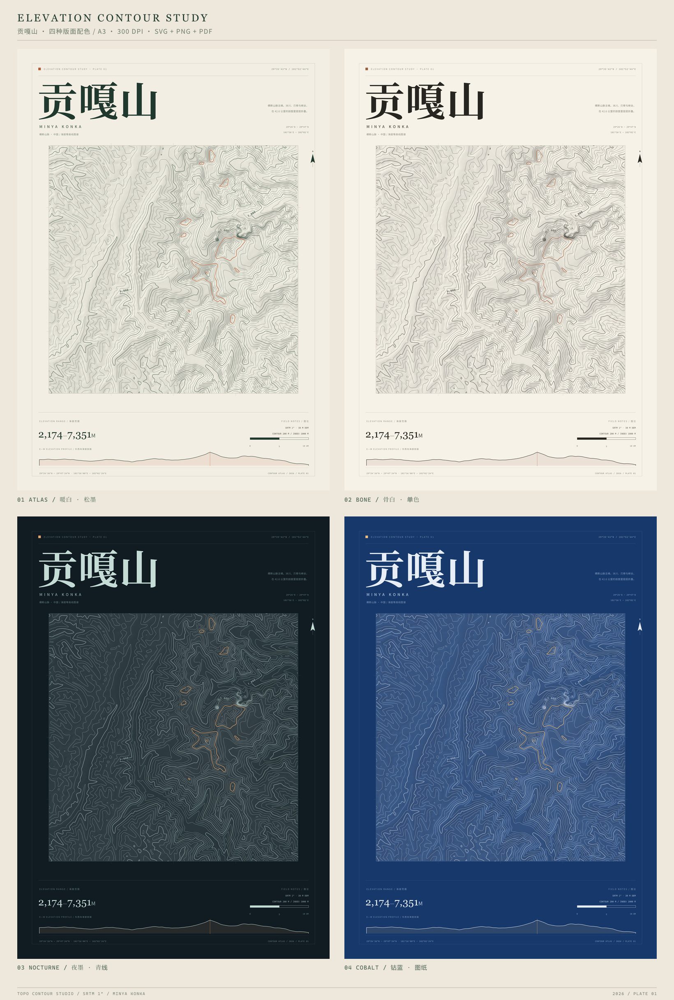
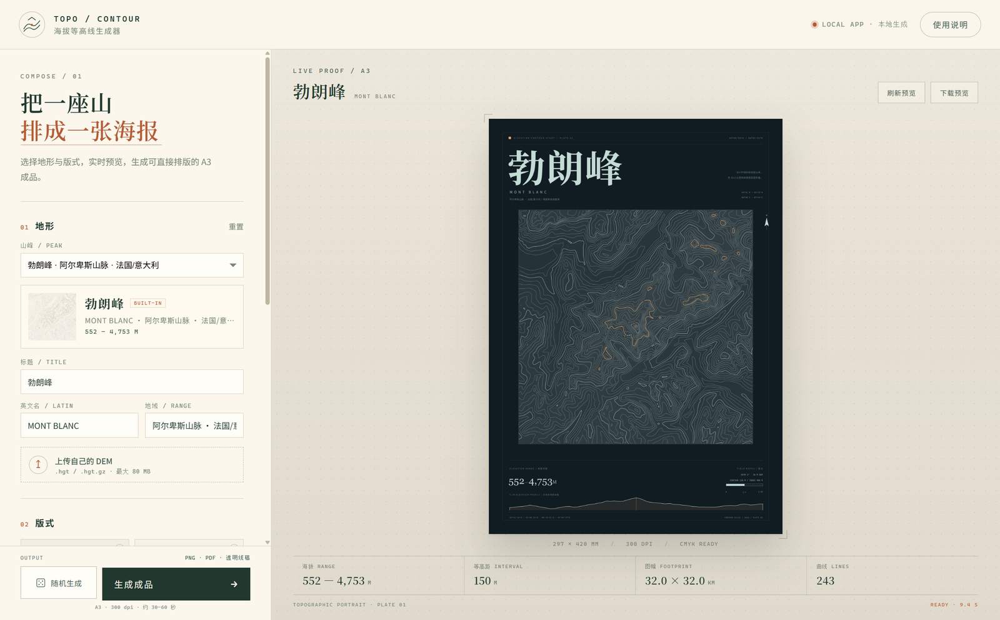
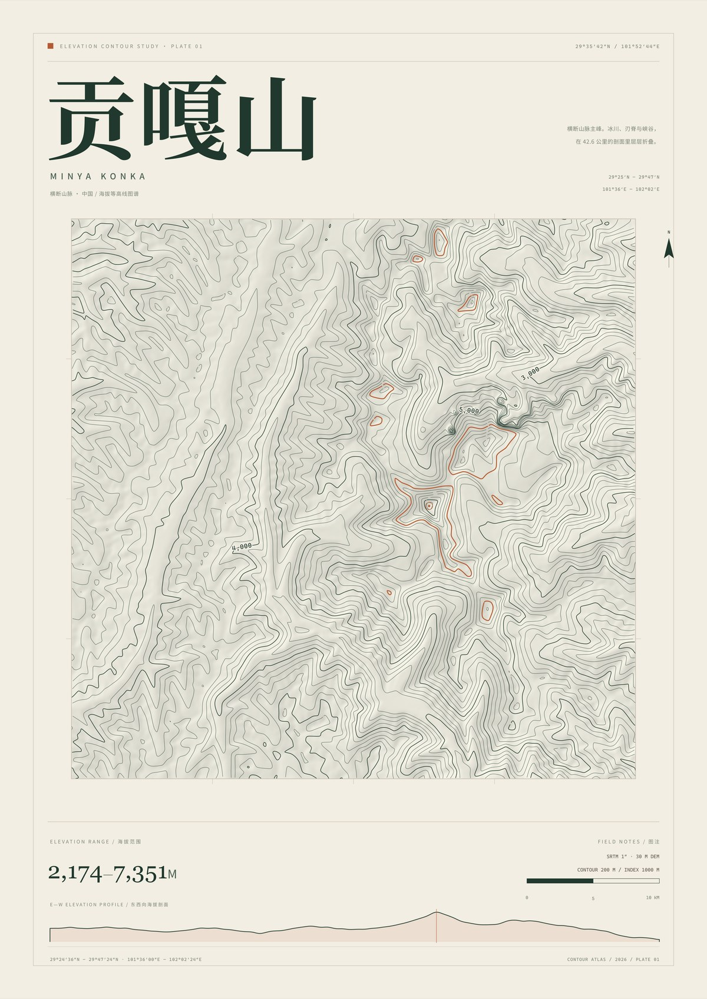

# 海拔等高线排版生成器 · Topo Contour Studio

把 DEM（数字高程模型）自动变成一张可直接排版的 **A3 海拔等高线海报**，并附赠透明底线稿。版式、配色、标注、比例尺、山脊剖面都会按地形数据自动生成。



参考方向：[小红书等高线海报](https://www.xiaohongshu.com/explore/69a73664000000001a023a36?xsec_token=ABYkWwZfnY3jTQS_uHcadFf6pvTZTN3i4SHs1XrDZMNR4=&xsec_source=pc_user)。本项目重新实现了地形取数、等高线追踪和版式系统，没有使用原帖图片素材。

---

## Windows 安装包（推荐）

直接运行：

**[从 GitHub Releases 下载最新安装包](https://github.com/qzz-z/topo-contour-studio/releases/latest)**

本地构建时安装包位于 `release/TopoContourStudio-Setup-1.2.0.exe`。

一键安装，自动创建桌面与开始菜单快捷方式。安装后从桌面打开 **Topo Contour Studio** 即可，不再需要命令行或浏览器。

- 安装包约 **110 MB**，安装后约 **365 MB**（内含 Electron 运行时和全部依赖）
- 首次启动可能需要 **10–30 秒**，之后会直接进入界面
- 输出文件在 **文档 / Topo Contour Studio / output**
- 安装包未做商业代码签名，Windows 可能提示“未知发布者”：点“更多信息” → “仍要运行”
- 本地构建时，免安装绿色版位于 `release/win-unpacked/`





界面里可以：

- 实时预览 A3 版式，改标题、配色、等高距、平滑度、标注和晕染都会立即刷新；
- 点左下角 **骰子按钮** 或按 **R** 键，随机切换一座真实山峰并生成一组协调参数；
- 上传自己的 `.hgt / .hgt.gz`，自动定位最高点并建议裁切范围；
- 一次生成 A3 300 dpi PNG、矢量 PDF、SVG、透明底线稿；
- 一键打包 ZIP 下载，文件同时保存在输出目录。

### 随机生成逻辑

随机功能从 **8 座真实 SRTM 山峰**中随机切换，坐标全部来自真实地理范围，不编造位置；随后再围绕这座山的地形特征生成版式参数。参数不是完全乱来，而是按地形高差做约束：

- 等高距从 50–400 m 中挑选，使高程层数保持在约 **16–50 层**，避免糊成一片或只剩几条线；
- 线条平滑度与等高距联动，细等高距用更小的平滑，粗等高距允许更舒展；
- 重点高程从海拔 **70%–85%** 区间取一条已有等高线，不会压在山顶；
- 配色会避开当前配色，保证每次点击都有明显变化；
- 高程标注和地形晕染按权重随机，但保持可读性。

### 源码 / 浏览器方式

如果你在使用源码，也可以双击 **`启动生成器.bat`**，或运行：

```bash
npm install
npm start
```

浏览器打开 `http://127.0.0.1:4318`。这是同一个界面的本地 Web 版本。

重新打包 Windows 安装包：

```bash
npm install
npx electron-builder --win nsis
```

---

## 成品内容

每次生成会得到多类文件：

| 文件 | 用途 |
| --- | --- |
| `*_poster.svg` | A3 矢量海报，可直接放入 Illustrator / InDesign |
| `*_poster.png` | A3、300 dpi、3508 × 4961 px，适合 Photoshop / PPT / 社交媒体 |
| `*_poster.pdf` | A3 单页矢量 PDF，中文正文已嵌入字体，适合打印和排版 |
| `*_art_color_ink.svg/png` | **透明底**彩色等高线线稿，可自由叠底、裁切、改色 |
| `*_art_ink_ink.svg/png` | **透明底**单色线稿，适合做专色、烫金、丝网印 |
| `*_art_*_light.svg/png` | 深色版式专用的浅色线稿 |

内置 4 套配色：

- `atlas` 暖白 · 松墨（主推）
- `bone` 骨白 · 单色（最克制）
- `nocturne` 夜墨 · 青线（深色）
- `cobalt` 钴蓝 · 图纸（蓝图感）

内置 8 座真实山峰：**贡嘎山、马特洪峰、玉龙雪山、富士山、勃朗峰、大格洛克纳、梅里雪山、南迦巴瓦**。全部为 SRTM 1″ DEM，按山峰位置裁切为 29–42 km 见方的地形窗口。

---

## 命令行生成

需要 Node.js 18+。

```bash
npm install
npm run build
```

生成结果在 `output/`。只生成主推配色：

```bash
node generate.js --preset gongga --style atlas
```

先出一张 1200 px 小图看效果：

```bash
node generate.js --preset gongga --style all --preview 1200
```

不生成 PDF 或透明线稿：

```bash
node generate.js --pdf false --art false
```

---

## 换成自己的山

### 1. 准备 SRTM `.hgt`

从 AWS Terrain Tiles 下载 1″ SRTM 瓦片，例如：

```text
https://s3.amazonaws.com/elevation-tiles-prod/skadi/N30/N30E103.hgt.gz
```

文件名必须包含经纬度，例如 `N30E103.hgt` 或 `N30E103.hgt.gz`。生成器会从文件名推断瓦片范围。

### 2. 指定裁切范围和标题

```bash
node generate.js --hgt data/N30E103.hgt --west 102.85 --east 103.25 --south 30.05 --north 30.35 --title "四姑娘山" --latin "SIGUNIANG" --range "邛崃山脉 · 中国" --style atlas --out output/siguniang
```

也可以直接传 JSON：

```bash
node generate.js --hgt data/N30E103.hgt --bounds "{\"west\":102.85,\"east\":103.25,\"south\":30.05,\"north\":30.35}" --title "四姑娘山"
```

建议：

- 裁切范围尽量接近正方形，海报会自动按地形宽高比排版。
- 经纬度跨度 0.3°–0.6° 比较适合 A3；太小会只剩几条线，太大线条会过密。
- `--lat` / `--lon` 用来指定封面坐标和剖面位置；不填则取裁切范围中心。
- 默认 200 m 等高距、1000 m 索引线；想更密可以用 `--interval 100 --indexEvery 5`。

### 3. 常用参数

| 参数 | 默认 | 说明 |
| --- | --- | --- |
| `--style` | `atlas` | `atlas` / `bone` / `nocturne` / `cobalt` / `all` |
| `--out` | `output` | 输出目录 |
| `--interval` | `200` | 等高距（米） |
| `--indexEvery` | `5` | 每几条画一条加粗索引线 |
| `--highlight` | 自动 | 用强调色高亮的高程，贡嘎默认 6000 |
| `--smooth` | `2.2` | DEM 平滑半径，越大线条越舒展 |
| `--simplify` | `0.75` | 线简化强度，越大越抽象 |
| `--labels` | `true` | 是否在图上标高程 |
| `--tint` | `true` | 是否加低透明度高程晕染 |
| `--preview` | 0 | 输出指定宽度的预览图，0 为 300 dpi 原尺寸 |
| `--pdf` | `true` | 是否生成 PDF |
| `--art` | `true` | 是否生成透明底线稿 |

---

## 版式说明

- 页面：A3 竖版，297 × 420 mm，无出血；四周 14 mm 细线框。
- 图形界面是本地 Node 服务，不上传任何地形或生成文件到云端。
- 地形图窗口：约 237 mm 见方，按 DEM 实际宽高比自动缩放。
- 字体：标题根据字数自动计算字号并**转成矢量路径**，不依赖本机字体；正文使用 Noto Serif SC / Noto Sans SC / Cascadia Mono。
- 图面信息：中心坐标、经纬范围、海拔范围、等高距、索引线间隔、10 km 比例尺、指北针、最高点标记、沿焦点纬线的东西向海拔剖面。
- 高程标注会自动避让：不贴边、不压山顶、不过度重叠；索引线标注会沿等高线切线旋转。
- 色彩：低海拔线更浅，高海拔线更深，6000 m 用陶土色强调。所有颜色都是 RGB，印刷前请在排版软件中转 CMYK。

> PDF 为了内嵌中文字体，正文使用 Windows 自带的 STSong / SimHei；标题是路径，所以和 PNG 完全一致。若要求正文也逐字一致，请以 SVG 或 300 dpi PNG 为准。

---

## 目录结构

```text
启动生成器.bat              一键启动本地软件（Windows）
server.js                   本地 HTTP 服务 + 预览 / 上传 / 生成 API
web/                        图形界面（HTML / CSS / JS）
generate.js                 CLI 入口
src/
  styles.js                 4 套配色与版式常量
  lib/
    dem.js                  DEM 读取、裁切、平滑、等高距
    contour.js              Marching Squares + 曲线平滑
    render.js               SVG 海报 / 透明线稿
    tint.js                 地形晕染
    pdf.js                  SVG → PDF（内嵌字体）
    pipeline.js             预览 / 生成共用的流水线
data/
  *.json                    8 座山峰的元数据
  *.bin.gz                  8 座山峰的 Int16 DEM（gzip）
tools/prepare_mountains.js 重建 8 座山峰的裁切 DEM
tools/publish_github.js    通过 GitHub API 发布仓库与 Release
tools/make_thumbs.js       生成山峰缩略图
tools/prepare_dem.js       重建贡嘎山示例数据
output/                     生成结果
```

---

## 数据与许可

- 示例 DEM：SRTM 1 arc-second（8 座山峰，含 N29E101/N29E102 等瓦片），来自 [AWS Terrain Tiles](https://s3.amazonaws.com/elevation-tiles-prod/skadi/)，公有领域。
- SRTM 的高程和位置存在约 ±16 m 量级的误差；山顶、深谷和陡崖处的等高线只适合视觉排版，不应作为测绘成果使用。
- 代码：MIT。
- Noto 字体：SIL Open Font License；STSong / SimHei 为系统字体，请按本机授权使用。

---

## 设计参考

版式语言参考了小红书上的等高线海报：大字号衬线标题、细密等高线、坐标与海拔元数据、克制的陶土色强调。实现上所有地理信息都来自 DEM，而不是装饰性随机线条。
